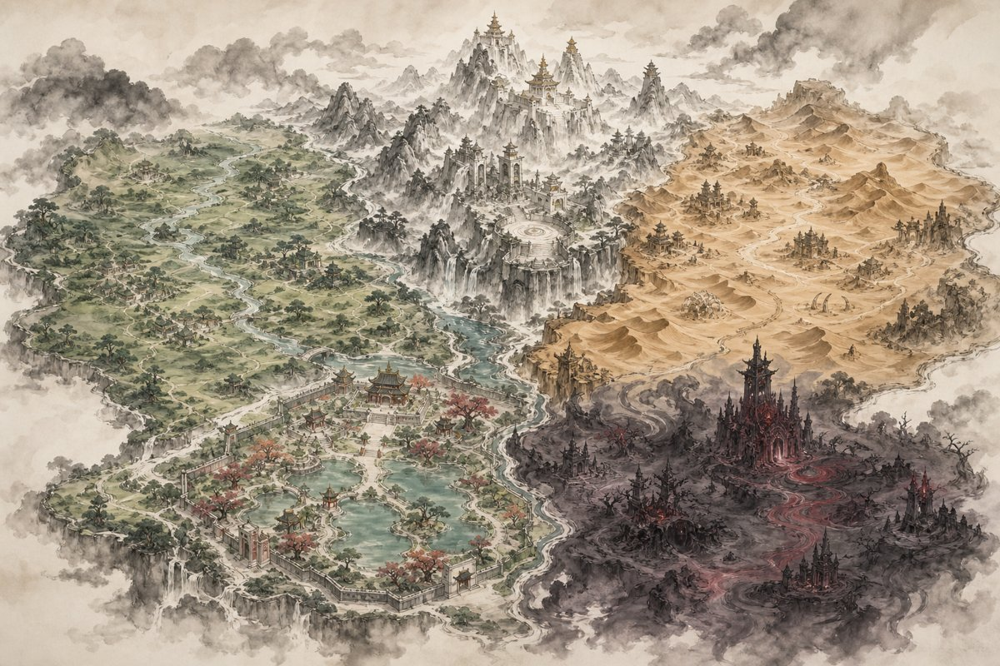

# Cursed Hoard

*[English](README.md) · Deutsch*

> **Stiehl das Königreich. Bewache den Hort.**

Ein Tower-Defense-Spiel in Java / libGDX, in dem man den Bösewicht spielt: Helden wollen die
Edelsteine aus dem verfluchten Schatz zurückstehlen, und man hält sie mit Türmen aus vier
Fraktionen auf. Die Grafik ist im Stil einer chinesischen Tusche-Querrolle gehalten.



## Funktionen

- **25 Kampagnen-Level in 5 Welten** mit eigenem Gelände, eigenen Gegnern und Bossen
- **4 Turm-Fraktionen** (Ork, Gruft, Dämon, Goblin) mit je 6 Ausbaustufen und zwei Zweigen
- **53 Heldentypen** mit Resistenzen, Immunitäten, Fluggegnern und Fähigkeiten
- **Edelsteine statt Leben:** Helden tragen Steine davon, fallengelassene kann man zurückholen
- **Fähigkeitenbaum, Verzauberungen, Almanach**
- **Karteneditor** für eigene Level

## Starten

Benötigt JDK 17 oder neuer:

```bash
./gradlew lwjgl3:run      # spielen (Windows: gradlew.bat lwjgl3:run)
./gradlew test            # Tests
```

Ohne Gradle: `tools/headless/compile-all.sh` (Typprüfung) und `tools/headless/run.sh`
(simuliert alle 25 Level).

## Lizenz & Entstehung

Code unter MIT-Lizenz, siehe [LICENSE](LICENSE).

Entwickelt mit KI-Unterstützung (Claude und Codex). Die Rastergrafiken sind KI-generiert
(Prompts in [assets/GENERATED_ASSETS.md](assets/GENERATED_ASSETS.md)). Spielidee,
Designentscheidungen (`redesign/DECISIONS.md`), Richtung und Playtests stammen von mir.
