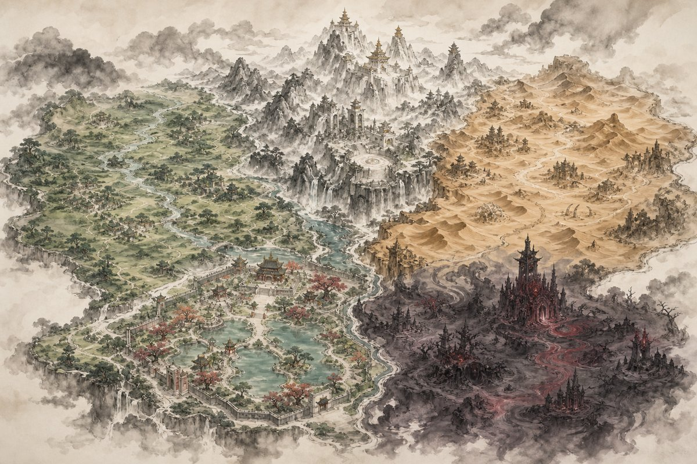

# Cursed Hoard

*English · [Deutsch](README.de.md)*

> **Steal the kingdom. Guard the hoard.**

A tower-defense game in Java / [libGDX](https://libgdx.com/) where you play the villain: heroes
march in to steal back the gems from your cursed treasure, and you stop them with towers from four
factions. The art is in the style of a Chinese ink-wash handscroll.



## Features

- **25 campaign levels across 5 worlds**, each with its own terrain, enemies and bosses.
- **4 tower factions** (Orc, Crypt, Demon, Goblin), each with a 6-tier upgrade tree and two
  branches.
- **53 hero types** with typed resistances, status immunities, flying units and special abilities.
- **Gems instead of lives:** heroes carry gems off the map, and a gem dropped on the road can be
  won back.
- **Skill tree, enchantments and an almanac** of every tower and enemy.
- **Map builder** for authoring levels from tiles.
- Music and sound-effect support; audio files are optional (see `assets/audio/README.md`).

## Run

Requires a JDK 17 or newer. Gradle is downloaded by the wrapper.

```bash
./gradlew lwjgl3:run      # play (Windows: gradlew.bat lwjgl3:run)
./gradlew test            # 27 JUnit test classes (balance, maps, waves, AI, UI layout)
./gradlew lwjgl3:jar      # runnable jar in lwjgl3/build/libs/
```

### Headless checks (no Gradle, no libGDX download)

`tools/headless/` type-checks the whole project against small libGDX stubs and plays all 25
levels with a scripted tower layout, which is handy without a network or GPU:

```bash
tools/headless/compile-all.sh   # type-check core + desktop launcher
tools/headless/run.sh           # simulate all 25 levels, prints a balance table
```

## Project layout

```
core/             game logic (game/), rendering & UI (assets/), screens
lwjgl3/           desktop launcher
assets/           runtime art, maps, wave definitions, sprite atlas
Game_assets_v2/   sprite source: palette + procedural sprite kits (open Gallery.html)
scripts/          Node scripts that export sprites and generate maps
redesign/         design documents: concept & lore, towers, troops, systems, maps, style guide
tools/headless/   stub-based compile and playtest harness
```

## License & credits

Code: MIT, see [LICENSE](LICENSE).

Built with AI assistance (Claude and Codex). The raster art was AI-generated; the prompts are
documented in [assets/GENERATED_ASSETS.md](assets/GENERATED_ASSETS.md). The game concept, design
decisions (see `redesign/DECISIONS.md`), direction and playtesting are mine.
